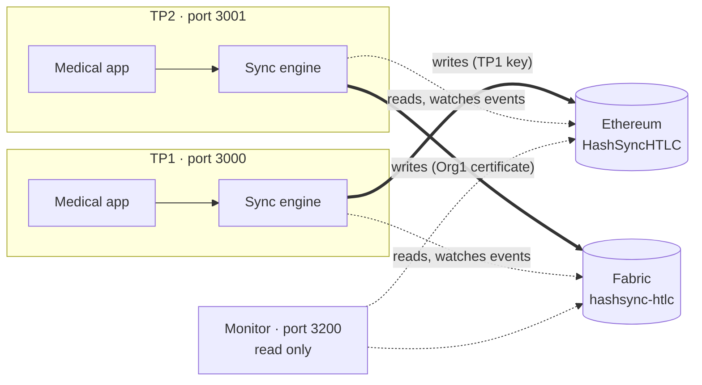
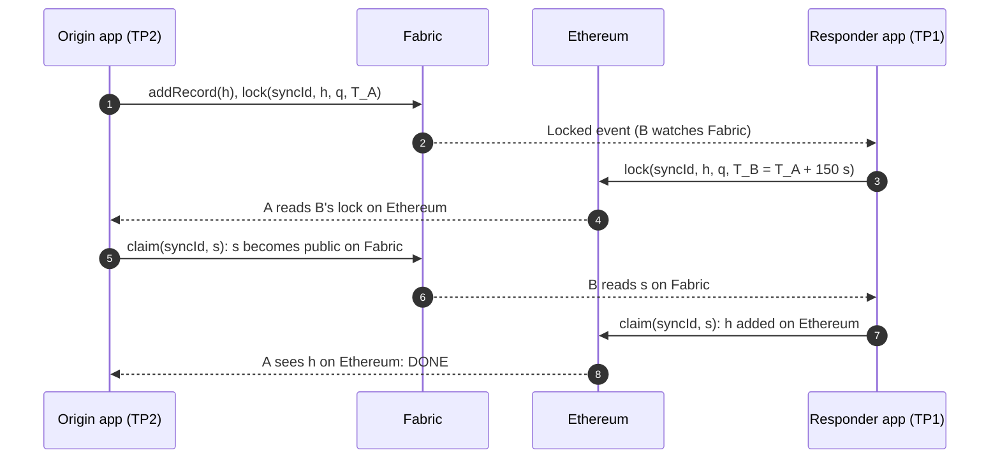
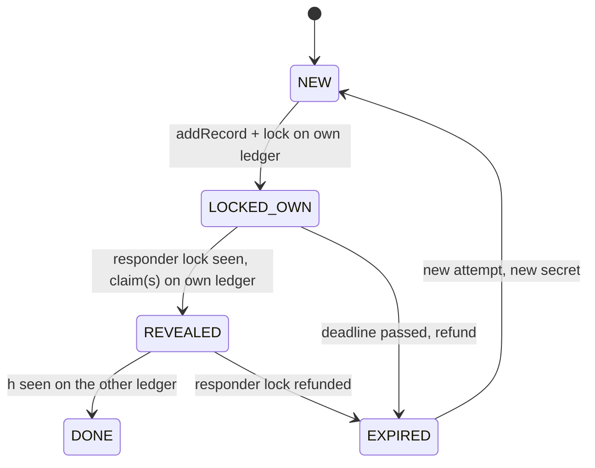
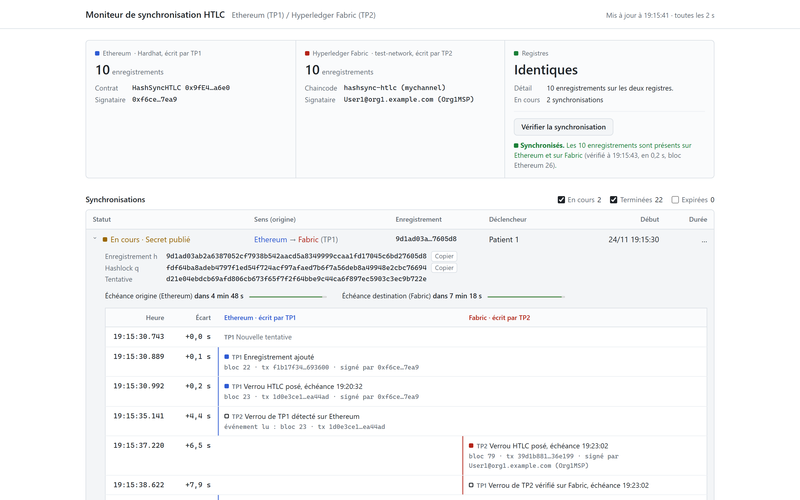
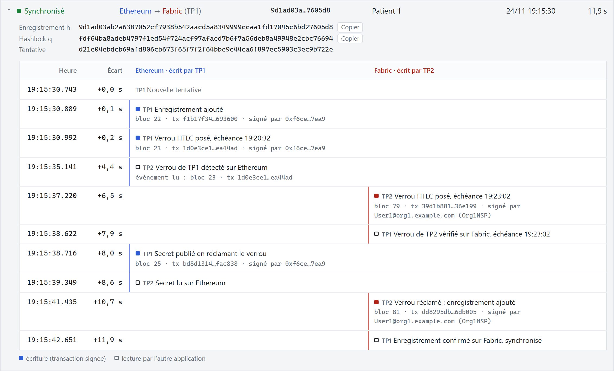
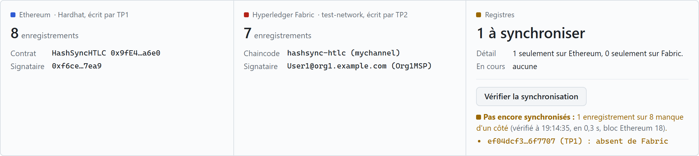

# Synchronising two ledgers with HTLCs (Ethereum ⇄ Hyperledger Fabric)

## 1. Goal

Two medical-record apps keep the SHA-256 fingerprint of each dossier on a ledger: TP1 on **Ethereum**, TP2 on
**Hyperledger Fabric**. Requirement: a record added to one ledger must eventually appear on the other, using an
**HTLC (Hashed Time-Locked Contract)**. There is no bridge and no message between the apps: each app writes only its
own ledger and reads the other.

## 2. What an HTLC is, and what it is for

An HTLC locks an asset under two conditions [1][2]: whoever reveals a secret `s` with `SHA256(s) = q` can claim it
(**hashlock**), and if nobody does before a deadline it returns to its owner (**timelock**). Revealing `s` to claim one
lock lets the other party claim a lock that uses the same `q`.

It was designed for **exchanges of value between parties who do not trust each other**: cross-chain atomic swaps
[3][4], payment routing in the Lightning Network [5][6], and asset exchange between Fabric and Corda networks in
Hyperledger Cacti [7]. The guarantee is atomicity: both transfers happen or both are refunded [4].

> **Synchronising records is not what an HTLC is meant for: it is the wrong primitive.** Copying a record from one ledger to another is
> replication, not an exchange: nothing of value is traded, the two apps cooperate instead of distrusting each other,
> and we need "eventually on both ledgers", not "both or neither". The HTLC is used here because the assignment
> requires it; section 7 sets out what this costs and what it brings.

## 3. Architecture



| | TP1 (Ethereum) | TP2 (Fabric) |
|---|---|---|
| Writes | contract `HashSyncHTLC`, signed locally with TP1's own key (sole operator) | chaincode `hashsync-htlc`, as `User1@org1` (only Org1MSP may write) |
| Reads | Fabric, as `User1@org2` | Ethereum, over JSON-RPC |
| Who pays | gas, from TP1's operator account | no fees (permissioned network) |

The contract and the chaincode hold the same two things: a grow-only set of record hashes `h`, and HTLC attempts
`syncId = SHA256(h ‖ q)` with `lock`, `claim(s)` (adds `h`, publishes `s`) and `refund` (after the deadline).

## 4. Protocol

The app where the record is created is the **origin** (A), the other the **responder** (B).



* Each step is checked on a ledger, never taken from a message.
* A reveals `s` on its own ledger first, so B's deadline is the later one (`T_B > T_A`).
* An attempt that runs out of time is refunded and A retries with a new secret. A record is never removed.
* Every 15 s each app re-sends any record of its ledger missing on the other (reconciliation).



## 5. Running it

### 5.1 Publishing anonymously (once)

The code lives in a **private** GitHub repository; reviewers get a public, anonymised copy from
[Anonymous GitHub](https://anonymous.4open.science), which hides the owner and repository name and replaces chosen
words in every file. The commit history already has a single anonymous author, and generated files (`.env`, keys,
databases, logs) are git-ignored.

1. Check before every push (names and logins are typed here only, never stored in the repository):
   ```bash
   ANON_TERMS="first name,last name,github login" npm run check:anonymous
   ```
2. Push to a private repository: `gh repo create htlc-ledger-sync --private --source . --push`
   (later changes: `git push`).
3. On anonymous.4open.science: sign in with GitHub, anonymise `htlc-ledger-sync` (branch `main`), list the same
   words to hide, allow downloads, optionally set an expiry date. Share only the resulting
   `https://anonymous.4open.science/r/<id>` link; it shows the files, not the commit history.

### 5.2 Running it

Prerequisites: Linux or **WSL2 (Ubuntu)**, Docker (Docker Desktop with WSL integration on Windows), Node.js 20+,
git, curl and python3 (included in Ubuntu), jq (`sudo apt install jq`). On Windows run every command **inside WSL**, with the code in the WSL file system (not `/mnt/c`).

The code is at **https://anonymous.4open.science/r/htlc-ledger-sync-FC78/**. Anonymous GitHub does not support
`git clone`, so download it with its zip link instead:

```bash
mkdir -p ~/htlc-ledger-sync && cd ~/htlc-ledger-sync
curl -L -o repo.zip https://anonymous.4open.science/api/repo/htlc-ledger-sync-FC78/zip
python3 -m zipfile -e repo.zip . && rm repo.zip      # unzip with Python (installed on Ubuntu)
npm run setup        # checks tools, downloads Fabric 2.5 if missing, installs, writes the .env files
npm start            # Hardhat + contracts, Fabric + chaincodes, TP1, TP2, monitor
```

Already have `fabric-samples`? Use `FABRIC_SAMPLES=/path/to/fabric-samples npm run setup`.

| Step | What to do |
|---|---|
| Open | TP1 http://localhost:3000 · TP2 http://localhost:3001 · monitor http://localhost:3200 |
| Log in (both apps) | `ali.medecin@test.com` / `Medecin123!` (doctor) |
| Fabric → Ethereum | TP2, patient page, "Connecter à Fabric", then "Enregistrer le dossier sur la blockchain" |
| Ethereum → Fabric | TP1 needs MetaMask: add network `http://127.0.0.1:8545` (chain 31337), import a Hardhat test account (keys printed at the top of `.run/logs/hardhat.log`), then "Enregistrer le dossier" on the patient page |
| Watch | the monitor shows each step per ledger; **"Vérifier la synchronisation"** asks both ledgers for every record |
| Without MetaMask | `npm run demo:eth-record` adds a record on Ethereum only; reconciliation copies it within 15 s |
| Authorisation check | `npm run demo:unauthorized`: Hardhat accounts are refused (`NotOperator`) |
| Tests | `npm test` (12 contract tests, 22 chaincode tests) |
| Stop / clean | `npm stop` keeps the Fabric ledger · `npm run reset` erases it and the app databases |

## 6. Results

| Test | Result |
|---|---|
| Dossier registered in TP2 → Ethereum | synchronised in 14.5 s |
| Dossier registered in TP1 → Fabric | synchronised in 8.6 s |
| Fresh Ethereum chain, 4 records on Fabric | all 4 copied by reconciliation |
| TP2 offline, short deadlines | lock refunded at the deadline, new attempt, finished once TP2 was back |
| Hardhat accounts writing to `HashSyncHTLC` | refused (`NotOperator`) |







## 7. Assessment

**Not the intended use.** HTLCs exist to exchange value atomically between parties who do not trust each other
(section 2). Here they carry data between cooperating apps, so most of their guarantees are unused and the work is
done by code around them.

**It only works because of what we added to the apps.** An HTLC is a lock; neither ledger knows the other exists, and
cross-chain communication is impossible without a trusted third party [8]. Here that role is played by components we
wrote: the contract and the chaincode, a sync engine and a ledger watcher in each app, credentials on the other
network, TP1's operator key, reconciliation and clock handling.

**Why it is not a good fit**

1. Wrong primitive: HTLCs solve fair exchange; we need replication between cooperating parties.
2. It checks that both sides followed the steps, not that the record is legitimate.
3. Trust moves into the apps (secret in SQLite, key in `.env`).
4. Both apps must be online before the deadlines.
5. Deadlines rely on two clocks: Hardhat's lags when idle, Fabric's comes from the client's proposal [9].
6. 5 transactions and 8 to 25 s per record, instead of 1 write.
7. Designed for value: its known attacks (free option [10], miner bribery [11]) show the mismatch.

**What it does well**

* No bridge holding keys for both chains, the most attacked component in practice [12].
* Each organisation keeps sole write authority over its ledger.
* Every step (locks, secret, claims, refunds) is on a ledger: a full audit trail.
* Every attempt ends (claim or refund); nothing stays blocked.

**Better options for this need:** proof-based data sharing (Hyperledger Cacti / Weaver [13]) or one shared ledger.
HTLC fits only if records are exchanged for value.

## 8. Implementing the approach

**On each ledger** (Solidity contract or Fabric chaincode, same rules):

```text
records: set of h                    attempts: syncId -> {h, q, deadline, status, secret}
addRecord(h)            only the ledger's owner app; idempotent
lock(id, h, q, T)       require id == sha256(h ‖ q), T > now, no attempt id   -> LOCKED, emit Locked
claim(id, s)            require LOCKED, now < T, sha256(s) == q               -> CLAIMED, add h, store s
refund(id)              require LOCKED, now >= T                              -> EXPIRED
```

**In each app** (a loop every 2 s; it writes only `own`, reads `other`):

```text
on record created h:                      # origin side
    s = random(32); q = sha256(s); id = sha256(h ‖ q)
    own.addRecord(h); own.lock(id, h, q, now + 300)
loop origin attempts:
    LOCKED_OWN: if other.attempt(id) is LOCKED with same h, q and T_B >= T_A + margin
                    own.claim(id, s)                       # publishes s on own ledger
                elif now >= T_A: own.refund(id); retry with a new secret
    REVEALED:   if other.hasRecord(h): DONE
loop Locked events on other ledger (origin != me):       # responder side
    check other.attempt(id) is LOCKED, enough time left
    own.lock(id, h, q, T_A + 150)
loop responder attempts:
    if other.attempt(id) is CLAIMED: own.claim(id, other.attempt(id).secret)   # adds h
    elif now >= T_B: own.refund(id)
every 15 s: for h in own.records missing on other: start an origin attempt
```

The real code is in `ledgers/ethereum/contracts/HashSyncHTLC.sol`, `ledgers/fabric/hashsync-htlc/` and
`sync/engine.js`.

## Sources

1. Bitcoin Wiki, *Hashed Timelock Contracts*. https://en.bitcoin.it/wiki/Hashed_Timelock_Contracts
2. *BIP 199: Hashed Time-Locked Contract transactions*, 2017. https://bitcoin.org/bip/199/
3. T. Nolan, *Alt chains and atomic transfers*, Bitcointalk, 2013. https://bitcointalk.org/index.php?topic=193281.0
4. M. Herlihy, *Atomic Cross-Chain Swaps*, PODC 2018. https://arxiv.org/abs/1801.09515
5. J. Poon, T. Dryja, *The Bitcoin Lightning Network*, 2016. https://lightning.network/lightning-network-paper.pdf
6. Bitcoin Optech, *Hash Time Locked Contract (HTLC)*. https://bitcoinops.org/en/topics/htlc/
7. Hyperledger Cacti, *Asset exchange: Fabric with Corda*. https://hyperledger.github.io/cacti/weaver/getting-started/interop/asset-exchange/fabric-corda/
8. A. Zamyatin et al., *SoK: Communication Across Distributed Ledgers*, FC 2021. https://eprint.iacr.org/2019/1128
9. Hyperledger Fabric Go shim, `GetTxTimestamp`. https://pkg.go.dev/github.com/hyperledger/fabric-chaincode-go/shim
10. R. Han, H. Lin, J. Yu, *On the optionality and fairness of Atomic Swaps*, AFT 2019. https://eprint.iacr.org/2019/896
11. I. Tsabary et al., *MAD-HTLC*, IEEE S&P 2021. https://arxiv.org/abs/2006.12031
12. *SoK: A Review of Cross-Chain Bridge Hacks in 2023*, 2025. https://arxiv.org/abs/2501.03423
13. Hyperledger Cacti, Weaver RFCs (data sharing). https://github.com/hyperledger/cacti/blob/main/weaver/rfcs/README.md
